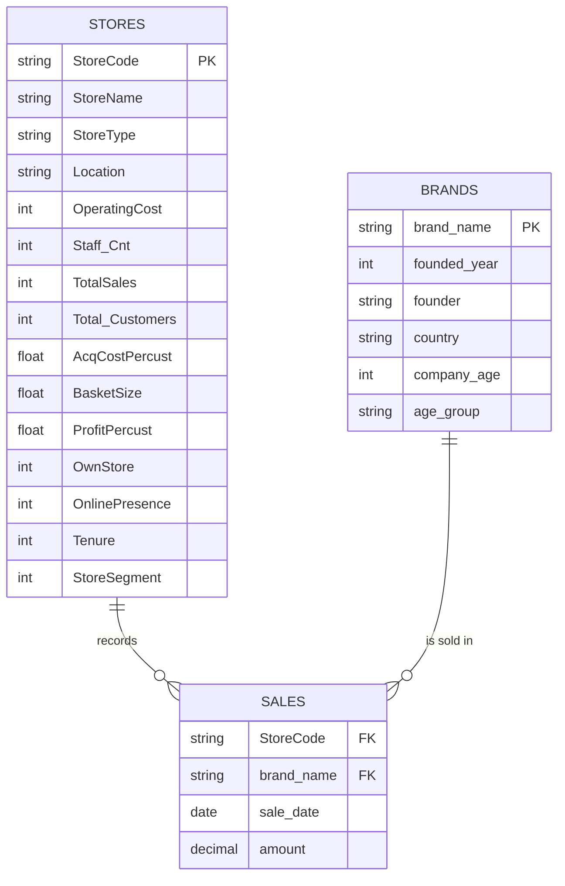

# Sephora Data Platform

Data modeling project for Sephora, covering the conceptual model, the three-layer architecture (Raw, DWH, DM) and the loading strategies.

## Project setup

- GroupId: `com.sephora.data`
- ArtifactId: `sephora-data-platform`
- Version: `1.0-SNAPSHOT`
- Java: 11
- Build: `mvn clean install`

Dependencies: Jackson Databind 2.15.3, JUnit Jupiter 5.10.1 (test scope).

## 1. Conceptual Data Model (MCD)



**Keys**
- `STORES.StoreCode` is the primary key. Check for duplicates.
- `BRANDS.brand_name` is the natural key. Check for duplicates and spelling variants.
- `SALES` is a placeholder linking stores and brands. It is not in the source files and must be confirmed.

**Cardinalities**
- Stores to Sales: 1:N
- Brands to Sales: 1:N

## 2. Three-layer architecture

| Layer | Table | Content | Load strategy |
|---|---|---|---|
| Raw | `raw_stores` | Exact copy of `stores_full.csv`, all 15 columns | Full (TRUNCATE + INSERT) |
| Raw | `raw_brands` | Exact copy of `brands_full.csv`, all 6 columns | Full |
| DWH | `dwh_stores_enriched` | Cleaned stores, plus `ca_par_client` = TotalSales / Total_Customers | Full |
| DWH | `dwh_brands_enriched` | Cleaned brands (country normalized to `USA`). Sales metrics pending the sales file | Full |
| DM | `dm_stores_par_location` | Per Location: store count, average TotalSales, total customers | Full |
| DM | `dm_brands_ranking` | Brands ranked by company_age and founded_year (temporary until sales data is available) | Full |
| View | `v_stores_own` | Stores where `OwnStore = 1` | None |

## 3. Data flow

```
stores_full.csv ──► raw_stores ──► dwh_stores_enriched ──► dm_stores_par_location ──► v_stores_own

brands_full.csv ──► raw_brands ──► dwh_brands_enriched ──► dm_brands_ranking
```

## 4. Data quality issues

- `StoreType` contains the typo `Electronincs`. Correct it in the DWH layer, not in raw.
- `country` contains `Usa` in one row. Standardize to `USA`.
- `age_group` values such as `21-50` can be converted to dates by Excel. Load as text.
- Units of `TotalSales` and `OperatingCost` are not documented. Confirm with the exercise.

## 5. Open points

- The sales file is missing. Without it, `nb_products`, `ca_total` and `categorie_dominante` cannot be computed.
- Employees, Products, Materials and Regions are not present in the provided files.