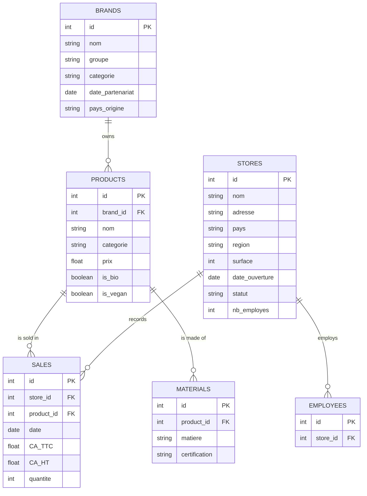

# Sephora Data Platform

Data modeling project for Sephora: conceptual model, three-layer architecture (Raw, DWH, DM), and loading strategies.

## Project setup

- GroupId: `com.sephora.data`
- ArtifactId: `sephora-data-platform`
- Version: `1.0-SNAPSHOT`
- Java: 11
- Build: `mvn clean install`

Dependencies: Jackson Databind 2.15.3, JUnit Jupiter 5.10.1 (test scope).

## 1. Conceptual Data Model (MCD)



**Keys and cardinalities**

| Relation | Cardinality | Meaning |
|---|---|---|
| Brands to Products | 1:N | One brand owns many products. Each product has one brand (`PRODUCTS.brand_id`). |
| Products to Sales | 1:N | One product appears in many sales lines. Each sale is for one product. |
| Stores to Sales | 1:N | One store records many sales. Each sale happens in one store. |
| Products to Materials | 1:N | One product is made of several materials. Each material row points to one product. |
| Stores to Employees | 1:N | One store employs many employees. Each employee works in one store. |

Brands and stores are not linked directly. They connect through products and sales.

**Status of the attributes**
- `BRANDS` and `STORES` match `brands_full.csv` and `stores_full.csv` exactly.
- `PRODUCTS`, `SALES`, `MATERIALS`, and `EMPLOYEES` follow the field names in the course material. Check them against the real files when they are available.

## 2. Three-layer architecture

| Layer | Table | Content | Load strategy | Requires |
|---|---|---|---|---|
| Raw | `raw_stores` | Exact copy of `stores_full.csv`, all 9 columns | Full (TRUNCATE + INSERT) | None |
| Raw | `raw_brands` | Exact copy of `brands_full.csv`, all 6 columns | Full | None |
| DWH | `dwh_stores_enriched` | Store columns + `nb_produits_vendus`, `ca_total`, `derniere_vente` | Full | `sales_full.json` |
| DWH | `dwh_brands_enriched` | Brand columns + `nb_produits`, `ca_total`, `categorie_dominante` | Full | `products_full.json`, `sales_full.json` |
| DM | `dm_stores_par_region` | Per `region` and `pays`: store count, total surface, average revenue | Full | DWH stores |
| DM | `dm_brands_ranking` | Brands ranked by revenue (`rang_ca`) and by product count (`rang_produits`) | Full | DWH brands |
| View | `v_stores_actifs` | Stores where `statut = 'OUVERT'` | None (computed on query) | DWH stores |

**Why full load everywhere:** the files are snapshots without a change flag, and the aggregates (ranking, dominant category, averages) depend on all rows. If the source files become incremental, switch the raw tables to delta (MERGE on `id`).

**Naming conventions:** prefixes show the layer.

| Prefix | Meaning | Example |
|---|---|---|
| `raw_` | Raw copy of the source, no transformation | `raw_stores` |
| `dwh_` | Cleaned and enriched data (warehouse) | `dwh_stores_enriched` |
| `dm_` | Data mart, aggregated for reporting | `dm_stores_par_region` |
| `v_` | View, no physical storage | `v_stores_actifs` |

## 3. Data flow

```
stores_full.csv ──► raw_stores ──► dwh_stores_enriched ──► dm_stores_par_region
                                          │
                                          └──► v_stores_actifs

brands_full.csv ──► raw_brands ──► dwh_brands_enriched ──► dm_brands_ranking
                                          ▲
                        products_full.json ─┴─ sales_full.json
```

## 4. Data quality checks (DWH layer)

- `statut`: confirm the full list of values. The course mentions `OUVERT` and `RENOVATION`.
- `categorie` (brands): use only `luxe`, `masspremium`, `mass`, `indie`.
- `groupe`: check for inconsistent spelling (`LVMH` vs `Lvmh`).
- `nom` (brands): check for duplicates.
- `pays` and `pays_origine`: use standard two-letter codes (`FR`, `US`, `ES`).
- Dates (`date_partenariat`, `date_ouverture`): keep in `YYYY-MM-DD` format.

## 5. Open points

- `products_full.json` and `sales_full.json` are needed for the DWH metrics. Their structure must be confirmed.
- `materials_full.xml` and `employees_full.csv` are needed for the Materials and Employees entities. The attributes shown are placeholders.
- The `SALES` table assumes an `id` key. Confirm it in the sales file.